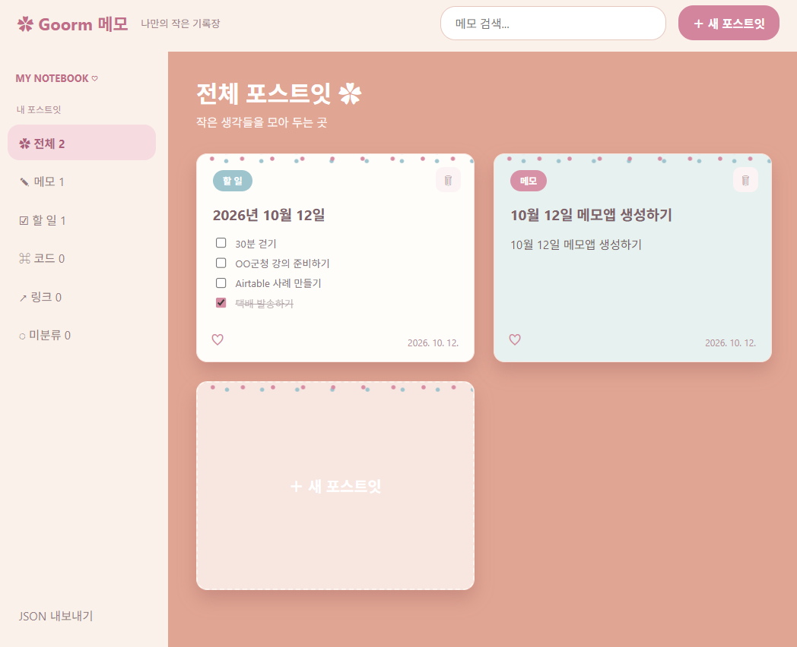

# Goorm 메모 (초기 구현)

Windows에서 Python 3.10 이상으로 `python app.py`를 실행합니다. 표준 라이브러리만 사용합니다.

화면은 제공된 포스트잇 이미지를 참고해 코랄 배경과 파스텔 카드형 메모로 구성했습니다. 새 포스트잇에서 `메모`, `할 일`, `코드`, `링크`, `미분류`를 선택할 수 있습니다. `할 일`을 고르면 항목별 체크박스로 입력하고, 카드에서 완료 상태를 바꿀 수 있습니다. 다시 열어 항목을 수정해도 체크 상태가 저장됩니다. 카드 오른쪽 위 휴지통 또는 편집창의 삭제 버튼으로 확인 후 포스트잇을 삭제할 수 있습니다. `preview.html`에서도 메모를 작성·수정·검색할 수 있고 브라우저 로컬 저장소에 보관합니다. 브라우저 미리보기 데이터와 Windows 앱의 데이터는 서로 연결되지 않습니다. 실제 앱은 `app.py`에서 실행합니다.

현재 구현: 로컬 JSON 자동 저장, 메모와 할 일 편집, 기본 및 사용자 분류 탭, 내용 기반 자동 분류, 분류 수정 사례 학습, 검색, 빠른 입력(`Ctrl+Alt+N`), 오늘 할 일 고정 창, 기한 알림 대화상자, 전체 JSON 내보내기. 할 일은 항목별 체크박스로, 코드 블록은 텍스트로 작성하고 다시 편집할 수 있습니다.

데이터는 `%LOCALAPPDATA%\GoormMemo\data.json`에 저장됩니다. 앱을 실행한 상태에서만 단축키와 알림이 동작합니다.

아직 남은 작업: 본문 링크 클릭, Windows 알림 센터 토스트와 클릭 시 해당 메모 열기, 백그라운드 상주 및 트레이 아이콘, 세 화면 사용성 정리, 설치 패키지. 현재 알림은 앱 내부 대화상자로 표시합니다.
